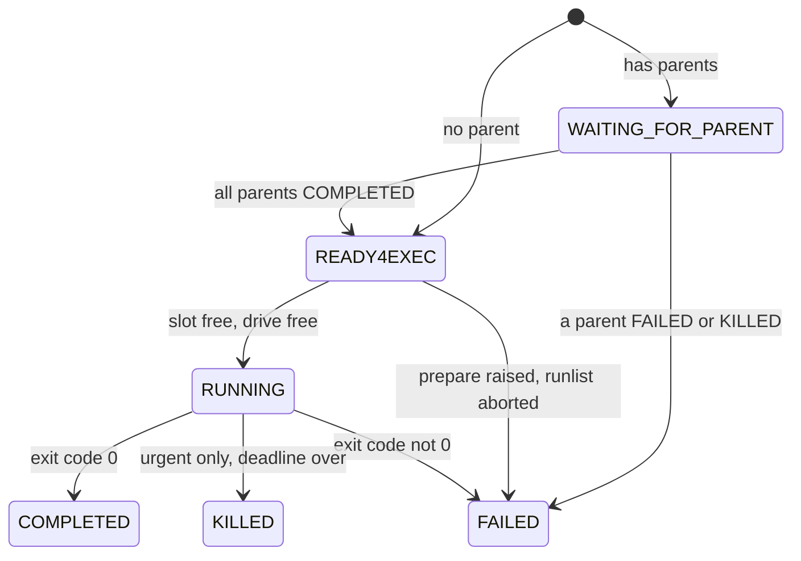

# Job

`backend/Job.py` is the batch system of the backend. It is the only place that starts a `Command`
on the host. A `Command` describes a process and observes it; `Job` wraps it in an `Entry`, decides
when it runs, and takes over the result.

There is **one queue for the whole host** (`Job.queue`), so the thread limit holds no matter how many
requests are queued. System commands that cannot wait live in a second list (`Job.urgent`). Both are
shown by `Job.Registry()`; `Job.Get()` and `Job.Wait()` find an id in either. Several requests can be
in the registry at once, for example one per drive; `Entry.drive` tells them apart (`Job.Registry(drive=)`).

## Entry

`Job.Add(cmd, ...)` returns the id of the new `Entry`.

| Argument     | Meaning                                                                             |
|--------------|-------------------------------------------------------------------------------------|
| `cmd`        | The `Command`, not started yet. The same object is never queued twice                |
| `tape`       | Drive id if the command uses a drive, `""` for CPU and disk work                     |
| `drive`      | Drive id (its wwid) of the request the entry belongs to, also for checksum, encryption and closing steps. A tape entry belongs to its own drive, so `tape` also sets `drive` |
| `dependsOn`  | Id of one parent that must be `COMPLETED` first                                      |
| `waitFor`    | Ids of further parents (a barrier, e.g. "all checksums are done")                    |
| `runlist`    | Id of the request the entry belongs to (one write, one restore)                      |
| `always`     | Closing step (final TOC, rewind): runs even if its runlist was aborted               |
| `prepare`    | Called right before the start, e.g. to make the final TOC. If it raises, the entry is `FAILED` and the command never ran |
| `urgent`     | See "Urgent entries"                                                                 |

Parents must be added before their children, so the queue is always in dependency order and a single
pass over it resolves the whole tree. An unknown parent raises `LookupError`.

## States



`COMPLETED`, `FAILED` and `KILLED` are final (`Job.FINISHED`).

## Runlist

All entries of one request share a runlist id. If one fails, every entry of that runlist that has not
started yet fails as well; running ones finish. Entries with `always=True` still run. Other runlists
are not affected. `Job.Failed(runlist)` tells whether an entry of the runlist failed (closing steps do
not count).

## Scheduling

`Job.Refresh()` is one tick: it updates the states, then starts what may start. In this order:

1. **Tape entries.** A drive works strictly in queue order, one entry at a time, so the order on the
   tape is known before anything is written. Drives are not limited by `Job.limit`.
2. **Entries that feed a tape** (checksum, encryption before a write).
3. **Everything else** (decrypt, verify after the tape).

The three classes are fixed, a request has no priority of its own. Within a class it is first come, first serve. CPU and disk work is limited by `Job.limit`
(default: the number of cores); every running entry without a drive takes one slot.

Who ticks: `Job.Work()` starts a thread that calls `Refresh()` every 500 ms (it does not start by
itself). `Job.Wait(ids, timeoutSec)` blocks until the entries are finished and ticks by itself, so it
works with or without the thread. `Job.Stop()` stops the thread.

## Urgent entries (system commands)

For small requests that must not wait for a slot: a few random bytes, `stat`, `findmnt`, a SCSI query.
They are not meant for the regular case.

- `Job.Add(cmd, urgent=True, deadlineMs=2000)` starts the command at once, in the caller's thread
  (the `Entry` constructor does it, `startAfterCreate`). `Job.Run(cmd, deadlineMs)` adds and waits and
  returns the finished `Command`.
- An urgent entry stands alone: no drive, parent, runlist or `prepare`. It takes no slot and never goes
  through the queue, so it can be used in constructors and in `prepare` hooks (they run under the Job lock).
- The deadline is wall-clock time. Whoever looks at the entry (`Job.Get()`, `Job.Refresh()`) enforces it:
  SIGTERM, 100 ms later SIGKILL, 100 ms later the entry is given up. State `KILLED`, `Command.killed`
  is set, `status_msg` says why. A process in uninterruptible sleep survives SIGKILL; `Job` does not wait for it.
- Deadlines: 2 s by default; 60 s for the `find` of a `Folder`, for writing the cartridge memory and for the TOC cipher.
- `Job.urgent` keeps the last 200 finished entries (`Job.URGENT_KEEP`).

## What Job does not do

- A queued command has no deadline. Stopping a running job is a matter of the API (abort, kill), not of the queue.
- Nothing is stored. The registry lives in memory and a new write or read request replaces it
  (`Job.Flush()`: `killRunning=True` kills and removes everything, `False` removes the finished entries only;
  `drive=` limits it to the entries of one drive, so the request of another drive is not touched).
- It does not know what a command means. Drive state and tape order are the business of `TapeDrive` and the jobs on top.

## Typical flow: write one file

```python
c = Job.Add(Command("openssl sha256 -r a"), runlist="w1")
e = Job.Add(Command("openssl aes-256-cbc ..."), runlist="w1", dependsOn=c)
w = Job.Add(Command("dd ... of=/dev/nst0"), runlist="w1", tape="drive-id", dependsOn=e)
Job.Work()
Job.Wait([w])
```

With a thread limit of 2 and four entries A, B (depends on A), C, D, the ticks look like this:

| Tick | Running | Why                                                    |
|------|---------|--------------------------------------------------------|
| 1    | A, C    | Both are ready, two slots; B waits for A, D has no slot |
| 2    | B, C    | A completed, B takes its slot                           |
| 3    | B, D    | C completed, D takes its slot                           |
| 4    | D       | B completed                                             |
